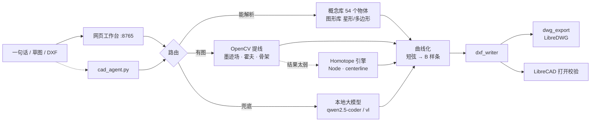

# J022 Ghoul · ghoul-cad

> 一句话或一张草图，直接产出可编辑的 DXF —— **纯本地运行，断网照用**。


把自然语言或手绘草图变成 CAD 能打开的图纸：本地大模型负责"理解"，
OpenCV 负责"量准"，确定性几何库负责"画对"，最后统一落到 DXF。

所有请求只走 `127.0.0.1`，不上传任何图片或文字。

---

## 它解决什么问题

| 你想做的事 | 以前 | 现在 |
|---|---|---|
| 画个五角星 / 齿轮 / 法兰 | 手动点 CAD | 打一句话，精确坐标直出 |
| 把手绘草图变矢量图 | 描一遍 | 传图 → 提线 → 曲线化 → DXF |
| 改图纸上的文字标注 | 在 CAD 里翻 | 网页里选中、拖、转、吸附 |
| 出差没网还想画图 | 没戏 | 模型和引擎都在本地 |

---

## 亮点

- **三级路由，越确定越不过模型**：概念库/图形库直出 → OpenCV 精确提线 → 大模型兜底。
  能算的绝不让模型猜。
- **颜色无关的墨迹识别**：淡红线、浅蓝线、铅笔灰线都能抓（先按 Lab 色差建墨迹场，
  不先转灰度 —— 转灰度会把淡彩线整根丢掉）。
- **真曲线，不是折线**：短弦链自动串成 B 样条，只对非精确几何生效，工程图的直边一根不动。
- **零依赖 DXF 读取**：没有 `ezdxf` 也能导入 DXF（内置纯 Python 解析器）。
- **能离线出 DWG**：随包的 LibreDWG 转换，失败也只丢 DWG、不丢 DXF。
- **会自我修复的启动器**：用错 Python 会自动换成带依赖的那个，并告诉你换了什么。
- **带桌宠**：右下角一只会说话的小家伙，看不懂报错可以直接问它。

---

## 快速开始

### 1. 拿代码

```bat
git clone https://github.com/J022BOT/Ghoul-cad.git
cd Ghoul-cad
```

> 如果你的网络访问 github.com 的 443 端口不稳定，改用 SSH 更可靠：
> `git clone git@github.com:J022BOT/Ghoul-cad.git`

> 路径**不要带空格**（LibreCAD 的静默安装不支持）。

### 2. 装运行时

双击 **`一键部署.bat`**，或者：

```powershell
powershell -ExecutionPolicy Bypass -File scripts\setup_runtime.ps1
```

它会把这 6 样东西装进当前文件夹（都可单独重跑）：

| 组件 | 落点 | 体积 |
|---|---|---|
| Python 3.13 + 依赖 | `python\` | ~260 MB |
| Node.js 22 | `tools\node\` | ~83 MB |
| @homotope/engine | `tools\homotope\` | ~1.4 MB |
| LibreDWG 0.14 | `tools\libredwg\` | ~32 MB |
| Ollama + 两个模型 | `ollama\` | ~1.6 GB + 10 GB |
| LibreCAD 2.2.2 | `LibreCAD\` | ~350 MB |

想省时间先跳过模型和大件：

```powershell
# 只装 Python 依赖（先看界面能不能开）
powershell -ExecutionPolicy Bypass -File scripts\setup_runtime.ps1 -Only python

# 跳过 10 GB 模型，之后手动 ollama pull
powershell -ExecutionPolicy Bypass -File scripts\setup_runtime.ps1 -SkipModels
```

### 3. 启动

双击 **`启动 Ghoo.bat`**。它依次：拉起 Ollama → 放出桌宠 → 启动网页工作台 → 自动开浏览器。

浏览器打开 <http://127.0.0.1:8765>，左栏是 AI 对话，右栏是"指令/草图 → DXF"，
下面是 CAD 编辑工作台。

> 第一次提问会冷加载模型，可能等 30~150 秒（机械盘/U 盘更慢）；之后模型常驻 30 分钟，
> 再次提问是秒回。

---

## 网页工作台

- **出图**：输入「画一个外接圆半径 60 的五角星」→ 直接出 DXF，可选同时出 DWG。
- **识图**：上传草图，勾选「只保留黑色线条」这类颜色条件，得到可编辑图元。
  出图前可以逐条勾选要保留的线段。
- **编辑**：选中直线/圆弧/样条后可以拖动、旋转、改图层。
  - 拖动时靠近其它图元会**吸附**（顶点/线段），接近水平竖直会自动**扶正**，两档强度可调；
  - 旋转按**与水平方向的绝对角**：填 `60` 就是与水平成 60°，选中时会显示当前夹角。
- **导入**：已有的 DXF 可以直接拖进来接着改（没有 ezdxf 也能读）。

命令行方式（不打开网页）：

```bat
python\python.exe app\cad_agent.py "画一个长 60 宽 30 的矩形，中心在原点"
python\python.exe app\cad_agent.py --image 草图.jpg "按这张草图出图"
python\python.exe app\cad_agent.py "画一个齿轮" --open
```

---

## 架构



细节（模块职责、判据阈值、为什么这么写）见 **[docs/ARCHITECTURE.md](docs/ARCHITECTURE.md)**。

---

## 目录结构

```
ghoul-cad/
├─ 一键部署.bat            ← 装运行时
├─ 启动 Ghoo.bat           ← 一键启动（服务 + 桌宠 + 浏览器）
├─ 只启动桌宠.bat
├─ 关闭运行.bat            ← 收尾：结束进程、刷缓存、安全弹出
├─ 诊断环境.bat            ← 逐项打印路径/版本
├─ app/                    ← 全部 Python 源码
│  ├─ launch.py            启动编排
│  ├─ web_app.py           网页服务（前端 JS 内嵌）
│  ├─ cad_agent.py         出图核心：指令/图片 → spec → DXF
│  ├─ concepts.py          54 个现实物体的参数化配方
│  ├─ shapes.py            几何基本形
│  ├─ line_extractor.py    OpenCV 提线（墨迹场/霍夫/圆弧分离）
│  ├─ organic.py           螺旋/手绘曲线的骨架化路线
│  ├─ curves.py            折线 → 样条
│  ├─ dxf_writer.py        写 DXF（R2000，中文安全）
│  ├─ dxf_reader.py        读 DXF（零依赖，ezdxf 兜底用）
│  ├─ dwg_export.py        DXF → DWG
│  ├─ homotope_bridge.py   Node 引擎桥
│  ├─ ollama_stream.py     流式请求（三道时限，防卡死）
│  ├─ desktop_pet.py       Win32 桌宠
│  ├─ voice.py / glitch_fx.py / mathtext.py
│  ├─ assets/              桌宠帧图、图标、背景
│  └─ _tests/              测试
├─ tools/homotope/         Node 侧 CLI（node_modules 由部署脚本装）
├─ scripts/setup_runtime.ps1
├─ docs/                   架构 / 排障 / 第三方许可
└─ requirements.txt
```

运行时目录（`python\` `ollama\` `LibreCAD\` `tools\node\` …）由部署脚本生成，不进版本库。

---

## 环境要求

- Windows 10 / 11 x64
- 磁盘 ≥ 13 GB（含两个模型）；只要界面和 CV，约 500 MB
- 内存 ≥ 8 GB（7B 模型推理建议 16 GB）
- 显卡可选：有 N 卡会快很多，纯 CPU 也能跑
- 首次部署需要联网；装完断网可用

---

## 测试

```powershell
# 必须用包内 Python（系统 Python 通常没有 numpy/cv2）
Get-ChildItem app\_tests\test_*.py | ForEach-Object { python\python.exe $_.FullName }
```

| 测试 | 覆盖 |
|---|---|
| `test_dxf_reader.py` | DXF 往返解析、ezdxf 缺失兜底 |
| `test_web_editor.py` | 内嵌 JS 语法 + 编辑器拖动/吸附/旋转 + 后端路由 |
| `test_runtime_guard.py` | 解释器定位与自动切换 |
| `test_homotope.py` | SVG path 解析、引擎桥、路由决策 |
| `test_curves_loose.py` | 曲线化阈值 |
| `test_bw_vs_color.py` | 黑白化与颜色过滤的先后顺序 |
| `test_arc_detect.py` / `test_organic.py` | 圆/弧判据、骨架化路线 |
| `test_dwg_export.py` | DWG 转换与依赖缺失拦截 |

---

## 已知限制

- **LibreCAD 2.2.2 打不开 LibreDWG 生成的 DWG**（上游问题）。程序遇到 `.dwg`
  会用资源管理器定位文件，请用 AutoCAD / 浩辰 / BricsCAD 打开，或直接用同时生成的 DXF。
- **二进制 DXF 不支持**（内置读取器只认 ASCII），请另存为 ASCII DXF。
- 只出 **R2000 格式 DWG**。
- 识图对**极低对比度的照片**（拍纸而不是扫描）还不够稳，建议裁掉背景再传。

---

## 常见问题

装不上、打不开、中文变方框、DWG 报错 —— 见 **[docs/TROUBLESHOOTING.md](docs/TROUBLESHOOTING.md)**。
最快的自检是双击 `诊断环境.bat`，它会逐项打印路径、版本、依赖状态。

---

## 许可

本项目以 [MIT](LICENSE) 发布。

随包/部署时用到的第三方组件（LibreCAD GPL-2.0、LibreDWG GPL-3.0、Ollama MIT、
Node MIT、@homotope/engine MIT 等）**不随仓库分发**，由部署脚本下载；
它们与本项目通过独立进程 + 文件交换协作。详见 [docs/THIRD_PARTY.md](docs/THIRD_PARTY.md)。

---

<p align="center"><sub>J022BOT · 桌宠 Ghoo（代号 J022 Ghoul）</sub></p>
