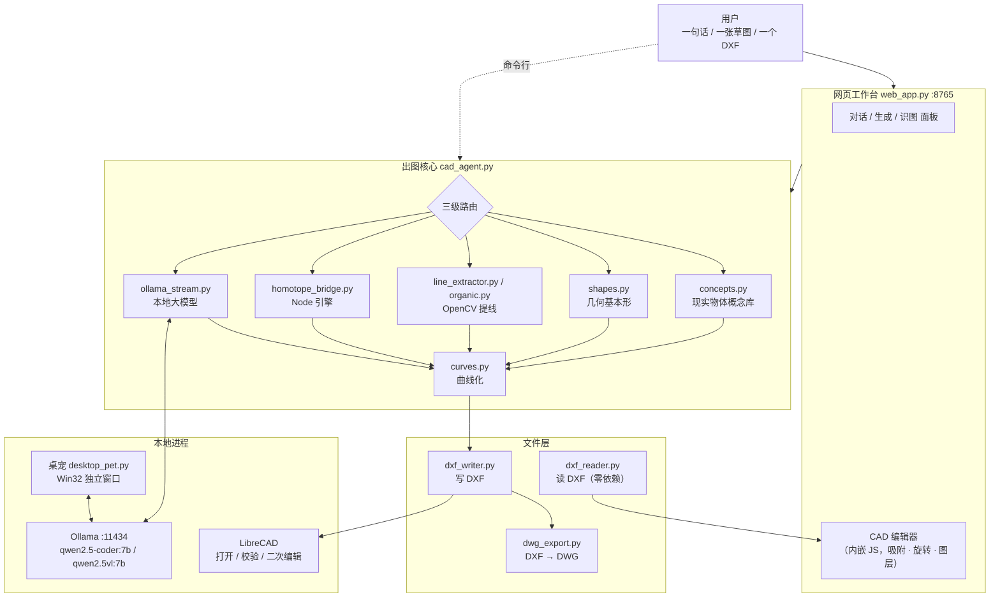
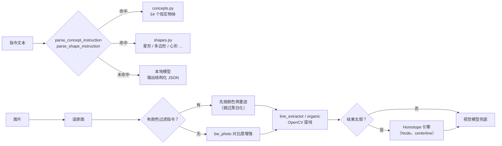

# 架构说明

本文说明 ghoul-cad 各部分怎么协作，以及那些"看起来奇怪但必须这么写"的地方。
只看代码容易踩坑的点，统一放在文末的 [关键不变量](#关键不变量别乱改) 一节。

---

## 1. 总览

整套系统是**单机闭环**：没有任何请求离开 `127.0.0.1`。



---

## 2. 启动链路

```
启动 Ghoo.bat
   └─ python\python.exe app\launch.py
        ├─ runtime_guard.ensure()      缺 numpy/cv2 就换个解释器重启自己
        ├─ ensure_ollama()             未运行则带 OLLAMA_MODELS 拉起 ollama serve
        ├─ start_pet()                 独立进程起桌宠
        └─ web_app.main()              前台跑 HTTP 服务，端口就绪后开浏览器
```

`只启动桌宠.bat` 走另一条更短的路径：`python\python.exe app\launch_pet.py`。

三条入口都会先过 `runtime_guard`，所以**用错解释器也不会静默坏掉**（细节见下节）。

---

## 3. 路径一律走 `portable.py`

```python
APP_DIR  = 本文件所在目录
PKG_ROOT = APP_DIR 的上一级（若 APP_DIR 名为 app）
```

于是同一份代码既能跑在仓库（`<repo>\app` → `PKG_ROOT=<repo>`），也能跑在便携包，
不写死任何盘符。查找顺序永远是 **环境变量 → 包内相对路径 → 历史兜底路径**：

| 变量 | 作用 | 兜底 |
|---|---|---|
| `J022_CAD_DIR` | DXF 输出目录 | `<包根>\CAD` → `D:/CAD` |
| `J022_LIBRECAD` | LibreCAD 主程序 | `<包根>\LibreCAD\librecad.exe` → 系统安装位置 |
| `J022_OLLAMA_EXE` | ollama 可执行文件 | `<包根>\ollama\ollama.exe` → 系统安装位置 |
| `OLLAMA_MODELS` | 模型库 | `<包根>\ollama\models` |

> 注意 Windows 文件名不区分大小写，`LibreCAD.exe` 与 `librecad.exe` 是同一个文件；
> 2.2.x 实际文件名是小写，`find_librecad()` 两种写法都试。

---

## 4. 解释器自检 `runtime_guard.py`

重依赖（numpy / cv2 / ezdxf）全是**懒加载**的，所以拿一个"干净"的 Python 启动，
界面照样能开 —— 只有真正点「生成」「导入 DXF」时才炸，用户看到的就是一句莫名其妙的
"未安装 ezdxf"。`runtime_guard` 把这个问题在启动时解决：

1. 试导入 `numpy` / `cv2`，都成功 → 什么都不做；
2. 缺了，按可信度找替代解释器：`J022_PYTHON` → 包内 `python\python.exe` →
   各盘根目录的 `J022-Ghoul-Portable\python\python.exe`（脚本所在盘优先）→
   PATH 里的每个 python → `%LOCALAPPDATA%\Programs\Python\*`；
3. 每个候选都**真的跑一次 `-c "import numpy, cv2"`** 验证（最多 12 个，结果缓存，
   U 盘冷启动给 30 s + 90 s 两档超时）；
4. 找到了就用它重启自己（`J022_RELAUNCHED=1` 防死循环，清掉 `PYTHONHOME`/`PYTHONPATH`）。

> 为什么不能只看"包内有没有 python.exe"：代码被放在仓库/开发目录时，
> 旁边根本没有 `python\`，但同一台机器上的便携包里有。

---

## 5. 从「一句话 / 一张图」到 DXF

入口是 `cad_agent.generate_dxf_detailed()`，路由顺序**不可颠倒**：



三种路线的分工：

| 路线 | 何时用 | 特点 |
|---|---|---|
| **concepts / shapes** | 指令能解析成已知概念 | 纯参数化直出，坐标精确、毫秒级，不过模型 |
| **OpenCV 提线** | 上传了图片 | 像素级准确；工程图（矩形、圆）保持精确几何 |
| **大模型** | 上面都不适用 | 兜底，输出 JSON spec，再由 `curves.py` 曲线化 |

### 5.1 OpenCV 提线为什么要"颜色无关墨迹场"

淡红线 RGB≈(216,216,240) 转灰度后亮度 220，与白纸几乎一样 —— 先 `cvtColor(GRAY)`
再 Otsu 会整根丢掉。所以：

- 用 Lab 色差 ΔE 建"墨迹场"，与颜色无关；
- 再加 2 遍色度通道专门捞淡彩线（灰阶 6 遍 + 色度 2 遍）；
- 阈值 = 噪声底 + 0.07 × 参考值，并做"低于阈值归纸色 + 3×3 模糊"清洗，
  否则 JPEG 振铃会让一条线变两条。

### 5.2 曲线化 `curves.py`

三道闸门，顺序固定：

1. 提示词层：要求模型直接输出 `spline` / `ellipse`；
2. `curveify()`：把"本来就是采样曲线"的 polyline 升级成 B 样条
   （判据：顶点数够、尖点占比 ≤ 20 %、非正多边形、非近似直线）；
3. `chain_lines_to_curves()`：把一串首尾相接的短直线串成一条样条 ——
   模型画弧最常见的输法就是一堆短弦。端点 3×3 网格聚类、"唯一候选"才前进
   （岔口即停）、跨拐角 > 45° 断链（保住圆弧与直边的接缝尖角）、只串同图层。

> `cv-lines` 精确描线与编辑器手绘**不做**曲线化：测绘结果不该被悄悄改形状。

闭合样条写 DXF 用**贝塞尔链 + 节点重数 3 的夹紧表示**。直接写周期节点向量的话，
合法定义域会变成 `[p, n+p]`，读取方从 `u=0` 采样时会外推出一个"钩子"
（实测首尾 gap 43 mm、切向差 51°）。

### 5.3 圆 vs 弧

`_detect_circles()` 返回 `(circles, arcs)`，两关：

1. **边缘判据**决定"够不够格"（支持率、最长弧长、切向性、径向偏差），这一关不能放松；
2. **墨迹剖面**决定"是整圆还是弧"：沿半径取墨迹段中心算半径（用边缘版会稳定偏大半个线宽，
   偏 2.7 px 就能让覆盖率从 360° 掉到 226°），再算最长连续弧占比 ——
   ≥ 90 % 是整圆，够长则输出 arc，否则丢弃。

判据 `scatter = 覆盖度 − 最长连续弧`：真弧约 0.11，文字/交叉凑出来的假圆 ≥ 0.36。

### 5.4 有机形状 `organic.py`

霍夫遇到螺旋、云纹、手绘曲线只能切出几百段短弦（一张漩涡图 232 条），这时走骨架路线：
墨迹 → Zhang-Suen 细化 → 沿骨架按方向穿越岔点 → 7 点滑动平均 → RDP → 直线/圆/样条。

触发判据 `looks_organic`：段数 ≥ 10 且中位段长 < 0.20 × 图幅对角、短段占比 > 0.5。
工程图不要走这条（矩形/圆本来就是精确几何）。

---

## 6. DXF 读写与 DWG 输出

### 读（`dxf_reader.py`，零依赖）

不依赖 ezdxf：按 组码对 → 实体切分 → 逐实体解析，支持 `LINE` `LWPOLYLINE`
`POLYLINE`(+`VERTEX`) `CIRCLE` `ARC` `SPLINE` `ELLIPSE` `TEXT` `MTEXT`。
SPLINE 用 de Boor 按控制点 + 节点向量采样。编码依次试 `utf-8-sig → gbk → cp1252 → latin-1`。
二进制 DXF 明确报错（只支持 ASCII DXF）。

> ezdxf 在就用 ezdxf，不在就自动退到内置读取器 —— 「未安装 ezdxf」不会阻断导入。

### 写（`dxf_writer.py`）

标准 AC1015（R2000）。中文要在 HEADER 声明 `$DWGCODEPAGE ANSI_936` 并按 GBK 落盘，
否则读取方按 cp1252 解码，中文标注全变乱码。

**让 LibreCAD 看见文字需要两件事同时成立**：

1. STYLE 表存在，且**样式名等于字体文件名** —— LibreCAD 拿样式名去 `resources/fonts/`
   找 `<名>.lff`，找不到就回落 standard（只有 ASCII 字形），Φ 和中文全变空心方块。
   所以样式用 `noto-sans-sc`，包内自带对应字体；
2. LibreCAD 的**草稿模式**会把所有文字画成方框。开关在注册表
   `HKCU\Software\LibreCAD\LibreCAD\Appearance\DraftMode`（2.2.x 迁到 `...\LibreCAD-2\Appearance`，
   两个都写），打开图纸前由 `cad_agent.ensure_librecad_text_visible()` 处理。

### DWG（`dwg_export.py`）

借助包内 LibreDWG 离线转换，只出 R2000。**永远先写 DXF 再转**：转换失败只回
`dwg_error`，DXF 照常交付。

两个容易卡死的点：

- `dxf2dwg.exe → libredwg-0.dll → libiconv-2.dll`，缺 libiconv **不报错**，
  而是弹一个模态"系统错误"框把后台转换永久挂住 —— 所以启动转换器**之前**就要拦住；
- 手写 DXF 缺 `LTYPE` / `BLOCK_RECORD` 时 LibreDWG 会报 `block_control missing`，
  所以转换前先用 ezdxf 重建一份"规范 DXF"。

---

## 7. 网页工作台 `web_app.py`

单文件 `ThreadingHTTPServer`，前端 JS **内嵌在同一个文件的 HTML 字符串里**，
没有构建步骤、没有类型检查。

主要接口：

| 路径 | 作用 |
|---|---|
| `POST /api/generate` | 指令 → DXF（可带 `fmt=dxf/dwg/both`） |
| `POST /api/extract` | 图片 → 图元（颜色过滤、多图、Homotope 辅助） |
| `POST /api/build` | 勾选后的图元 → DXF |
| `POST /api/import_dxf` | 导入已有 DXF |
| `POST /api/save` | 编辑器内容 → DXF / DWG |
| `POST /api/chat` | 本地模型对话（带图可切视觉模型） |
| `POST /api/env` | 运行环境自检（解释器、库版本、缺失项） |
| `POST /api/homotope_status` | Node 引擎是否可用 |
| `POST /api/dwg_status` | DWG 转换器是否可用 |
| `GET /open?file=` | 用 LibreCAD 打开生成的文件 |

### 编辑器（内嵌 JS）

- 图元：`line` `polyline` `circle` `arc` `spline` `ellipse` `rect` `text`
- 选择集 `selSet` 里存的是**图元对象引用**，不是下标
- 拖动用**快照式重算**：`drag.bases` 深拷贝，每帧 `applyMoveFromBases()` 从快照重算，
  而不是累加位移 —— 否则吸附吸住后又会滑走
- 吸附三档可调：位移正交、线条扶正（保长度只挪端点）、顶点/线段吸附
- 旋转按**与水平方向的绝对角**：填 60° 就是与水平成 60°，不是转 60°

> 改这里必须 `grep -n` 对齐所有调用点，并跑 `python app\_tests\test_web_editor.py`
> （它用 node 跑真实源码切片：`node --check` 整页 + 假 canvas 的交互断言）。
> JS 崩在 `mousemove` 里会导致整个拖拽静默失效，Python 侧测试完全照不到。

---

## 8. 桌宠 `desktop_pet.py`

Win32 ctypes 手工窗口 + 逐像素透明（`UpdateLayeredWindow`），动画状态机驱动 15 张帧图。
语音走 `voice.py`（SAPI5 离线 / Edge TTS 在线），装饰特效在 `glitch_fx.py`
（霓虹描边、HUD 角框、扫描线、故障闪光），都不修改原始帧、也不参与命中测试。

> 窗口类只注册一次，**WNDPROC 回调必须放在进程常驻字典里**
> （`_CLASS_PROCS` / `_EDIT_PROCS`）。否则 GC 回收后一点击就崩（0xc000041d）。

---

## 9. 关键不变量（别乱改）

1. **所有 `.bat` 必须 CRLF 行尾**，内容保持纯 ASCII（中文只出现在文件名里）。
   LF 会让 `if` / `goto` 块解析错乱。
2. **可移动介质绝不能用 `diskpart remove all dismount`**：`remove all` 会连盘符一起删，
   下次插 U 盘彻底没反应。用 `eject_native.ps1`（`FSCTL_LOCK_VOLUME` /
   `FSCTL_DISMOUNT_VOLUME` / `IOCTL_STORAGE_EJECT_MEDIA`）只释放卷。
3. **Ollama 请求统一走 `ollama_stream.stream_ollama_chat`**（三道时限 + 读头总闸），
   不要用 urllib 一次性阻塞读；网页端并发请求要过 `_MODEL_LOCK` 单飞闸门。
4. **`cv-lines` 的精确路径不做 `curveify`**：形状不该被悄悄改变。
5. **DXF 里 ARC 读回保留 `arc` 类型**（带细分点）。摊成 polyline 会丢掉"这是一段弧"的语义，
   编辑器的画/命中/拖动/旋转/擦除都要覆盖 `arc`。
6. **图片识线禁止先转灰度再 Otsu**：淡彩线会整根丢失（见 5.1）。

---

## 10. 测试

```powershell
# 全部跑
Get-ChildItem app\_tests\test_*.py | ForEach-Object { python $_.FullName }
```

| 测试 | 覆盖 |
|---|---|
| `test_dxf_reader.py` | DXF 往返解析、手写组码、ezdxf 缺失兜底、解释器自检 |
| `test_web_editor.py` | 内嵌 JS 语法（node --check）+ 编辑器交互断言 + 后端路由 |
| `test_runtime_guard.py` | 解释器定位、跨目录查找、重启防循环 |
| `test_homotope.py` | SVG path 解析、Node 引擎桥、路由决策 |
| `test_curves_loose.py` | 宽松曲线化阈值 |
| `test_bw_vs_color.py` | 黑白化 vs 颜色过滤的顺序 |
| `test_arc_detect.py` | 圆/弧分离判据 |
| `test_organic.py` | 骨架化路线与触发判据 |
| `test_dwg_export.py` | DWG 转换与缺失依赖拦截 |

自动化测试**必须用包内 Python**（`python\python.exe`），系统 Python 通常没有 numpy/cv2。
